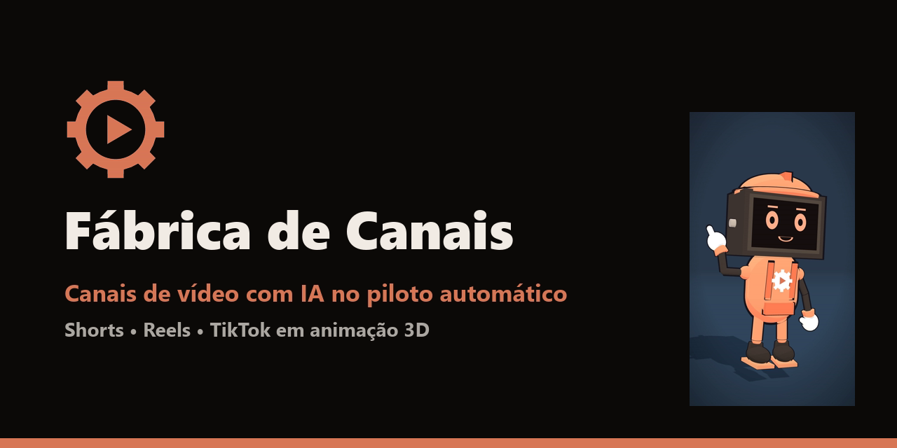

<div align="center">



<p>
  <a href="https://sparks-gamesstudio.github.io/fabrica-de-canais/"></a>
  <a href="https://pay.kiwify.com.br/GxCUqZm"></a>
  <a href="https://instagram.com/afabricadecanais"></a>
</p>


</div>

---

## 🏭 O que é

Este é o site da **Fábrica de Canais**: uma equipe inteira em forma de software que cria vídeos curtos sozinha, da ideia ao post agendado, com animação 3D e narração por IA.

<table>
<tr>
<td align="center" width="50%">
  
  <br/><b>⚽ @boleiro3d</b>
</td>
<td align="center" width="50%">
  
  <br/><b>🏭 @afabricadecanais</b>
</td>
</tr>
</table>

## 🗺️ Páginas

| Página | O que tem |
|---|---|
| [Início](https://sparks-gamesstudio.github.io/fabrica-de-canais/) | O que a fábrica faz e os canais no ar |
| [Pack 7 Skills](https://sparks-gamesstudio.github.io/fabrica-de-canais/skills.html) | As skills à venda, perguntas frequentes e garantia |
| [GitHub](https://sparks-gamesstudio.github.io/fabrica-de-canais/github.html) | Os repositórios grátis e como baixar |
| [Quem somos](https://sparks-gamesstudio.github.io/fabrica-de-canais/quem-somos.html) | A história da fábrica |
| [Contato](https://sparks-gamesstudio.github.io/fabrica-de-canais/contato.html) | Como falar com a gente |

## 📁 Como está organizado

```
├── index.html, skills.html, ...   páginas do site
├── assets/                        imagens, vídeos de exemplo e estilo (site.css)
│   ├── canal/                     último vídeo postado, atualizado pela fábrica
│   ├── pack/                      páginas do PDF do pack
│   └── github/                    imagem de prévia deste repositório
└── marca/                         logos e símbolo
```

O site é só HTML e CSS, sem build: cada push na branch principal já vai para o ar pelo GitHub Pages.

## 🛠️ Feito com

<p>
  
  
  
  
</p>

---

<div align="center">
  <sub>Feito por <a href="https://github.com/sparks-gamesstudio">Sparks Games Studio</a> · © 2026 Fábrica de Canais. Todos os direitos reservados.</sub>
</div>
